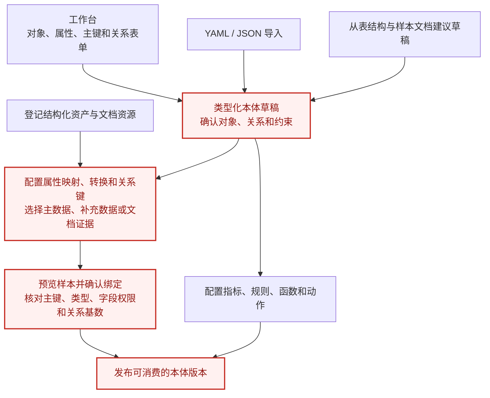
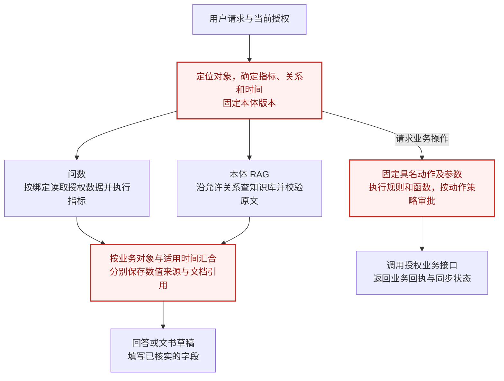

# MimirQ 企业本体设计规格

设计稿 · 2026-11-23

**2026-11-27 实现状态。** 普通与流式聊天将已发布本体的查询结果、关系证据、概念来源和授权原文送入同一证据预算与统一生成。具名查询以确定性 SQL 在授权范围内计算，枚举筛选值来自当前发布定义；动作提案仍经既有审批和回执流程。当前 50 题分别评审最终答案与生成前上下文：本体＋RAG 答案严格通过 50/50，上下文充分 50/50、上下文完整且聚焦 26/50。RAG 与 RAG＋SQL 的两项分数及配对结果见[双维度报告](../../artifacts/enterprise-qa/2026-11-26-fusion/final-concept-answer-scope-full-50-default8/dual-evaluation-report.md)。这些结果来自合成语料，不等同于生产数据验收、形式蕴含推理器或 OG-RAG 超图。

同一次请求可以按业务对象查询结构化数据、找回知识库中的原文，也可以把两类证据填入文书模板。企业本体维护对象身份、关系、数据绑定、指标和可执行行为，让各入口使用同一套业务定义。现有 MimirQ 用户、租户、组和知识库权限提供调用身份与文档访问范围。

维修工单是本文的验收示例。对象类型、指标和行为由业务域配置，可以用于其他领域。

## 使用场景

| 场景 | 用户请求 | 可核验的交付 |
| --- | --- | --- |
| 企业对象查询 | 查设备 E-102 的工单 | 能区分同名设备，按已绑定的主键读取有权访问的工单 |
| 问数 | E-102 本月到期且现在逾期的工单有几张 | 数值、指标口径、统计时间、数据来源和观察时间 |
| 本体 RAG | 这台设备的维修时限按哪份制度执行 | 按设备及其类别识别适用规定，从有效文档版本定位原文 |
| 混合问答与文书 | 给出逾期数量、适用制度，并生成整改说明草稿 | 汇合已核实的数值与制度原文，显示来源及待确认字段 |
| 业务操作 | 关闭指定工单 | 按当前状态、输入和授权执行保存的动作，提供业务回执 |

## 本体、数据资产和行为的契约

| 对象 | 保存内容与判断依据 |
| --- | --- |
| 本体版本 | 归属租户和业务域。工作稿可以编辑，发布版本固定实体、关系、绑定、指标及行为的定义。导入格式版本和发布版本分别标识。 |
| 对象类型 | 语义标识、显示名称、属性、类型、必填、多值、枚举及有序业务主键。对象引用包含租户、本体、对象类型、业务键命名空间和键值。业务键命名空间由权威来源决定，切换连接或表名时可沿用原命名空间。 |
| 关系类型 | 语义标识、起终对象类型、方向和基数。每条可用于结构化读取的关系配置外键或中间表。文档关系分别保存端点和证据。 |
| 数据资产 | 现有连接或文档资源的标识、来源类型、表或视图、列类型、候选主键、资产结构版本和访问范围。来源凭据由连接管理。 |
| 数据绑定 | 保存对象类型、资产、身份列、属性到源字段的映射、类型和枚举转换、关系键及来源角色。预览返回样本、校验问题及其归属字段。 |
| 指标 | 指标标识、业务定义、聚合表达式、统计粒度、适用维度、必需筛选、单位、时区和时间字段。登记本月、截至当前等时间短语使用的业务口径。 |
| 概念来源 | `concepts` 维护名称、别名、说明与来源文档 ID。`concept_ids` 定位原文，不要求一个虚构的业务实例，也不代替指标计算或动作授权。来源使用当前调用者的知识库、文档与发布版本范围。 |

概念可在高级定义中配置。例如特殊旅客服务概念可以关联实际登记的服务制度文档，定义名称、别名和职责说明，不把题目、答案或固定阈值写进概念说明。问答选择已发布概念后，系统取回当前可读、处理版本匹配的原文，继续执行普通 RAG 与统一生成；不可读或失效的来源不作为事实使用。

**来源角色。** 主数据绑定确定结构化实例的身份，发布版本内每个结构化对象类型绑定一个权威主来源。补充数据按声明的关联键增加属性，预览核对唯一性和关联基数。文档证据可连接实例、对象类型或业务规则。文档类型的实例可使用文档身份。多份数据源表达同一个实例时，系统按已确认的身份映射关联。

**映射与绑定。** 映射描述每个逻辑属性从哪一列取值、如何转换，以及对象关系走哪条关联路径。绑定将这些规则固定到正式登记的资产和对象类型上。实际查数时读取已保存的绑定，执行端验证列和来源权限。

**著录字段。** 文种、文号、发文单位、生效时间和有效期等字段各自登记类型、提取或填写方式及来源位置。互相矛盾的值并列留痕，待用户确认后标示可用值。

## 建模、映射与绑定



工作台的对象编辑区维护业务主键、属性、类型与枚举。关系编辑区维护起点、终点、方向和基数。映射页选择实际资产、身份列、转换和关系键，显示预览结果与错误位置。行为页配置规则、函数和动作。YAML/JSON 与表单使用同一套类型化契约，导入结果进入工作稿，可继续在界面编辑。AI 生成的定义和映射带来源说明，确认后进入工作稿。模型发布检查字段和关系引用、主来源及动作引用的一致性。

以下 YAML 展示相同对象从类型定义接到物理资产。指标和行为在同一个工作稿按对象标识引用。示例资产为验收夹具。

```yaml
schema_version: 1
ontology: maintenance
object_types:
  equipment:
    key: [equipment_id]
    properties:
      equipment_id: string
      name: string
  work_order:
    key: [order_id]
    properties:
      order_id: string
      equipment_id: string
      due_at: datetime
      status: {type: string, enum: [OPEN, CLOSED]}
relations:
  order_for_equipment:
    from: work_order
    to: equipment
    cardinality: many_to_one
bindings:
  - object_type: equipment
    role: primary
    asset_id: ops.equipment
    identity_columns: [id]
    columns: {equipment_id: id, name: name}
  - object_type: work_order
    role: primary
    asset_id: ops.work_orders
    identity_columns: [id]
    columns: {order_id: id, equipment_id: asset_id, due_at: deadline, status: state}
relation_bindings:
  order_for_equipment:
    source_columns: [asset_id]
    target_columns: [id]
```

绑定的错误状态包括主键缺失或重复、源字段不存在、转换失败、关联基数不符和权限不足。台账保存具体字段、资产与版本。必需绑定可用后，对应读取能力就绪。文档和数据变化各自记录观察时间。

## 两条数据路径

### MySQL、表格和其他结构化来源

注册表或视图时读取结构、主键和字段权限。预览根据当前访问范围读取少量行。执行问数时从版本绑定解析逻辑属性、业务主键和 JOIN，再按指标的粒度、时间、维度与必需过滤生成并校验查询。计数在关联扩展后按指标粒度去重。

源库与快照都先按当前调用者权限裁剪行，再做筛选、关联和聚合。筛选字段、关联键和派生指标使用的列也在授权范围内。仅允许查看汇总的指标由来源策略显式授权其计算依赖与可返回粒度，行权限继续生效。

| 读取方式 | 执行位置与证据 |
| --- | --- |
| MySQL 源库读取 | 使用已授权的连接与表或视图，从绑定编译参数化只读查询。回执标明源资产、查询标识、指标版本和观察时间。历史状态查询需要来源提供历史状态或相应时间点的快照。 |
| MimirQ 快照读取 | CSV、Excel 和 DB Catalog 行快照沿用 Table Store/TAG。回执记录导入批次、覆盖范围和快照时间。无法覆盖所问统计范围时，结果以有限范围返回并说明其口径。 |
| EDO 能力接入 | MimirQ 发布版的绑定记录 EDO 本体 ID 和期望工作修订。运行时按该修订调用只读能力，保留来源、实例投影和同步时间。修订变化时该绑定进入待复核状态。EDO 当前问数按保存关系读取授权投影，再装载准备表执行只读 SQL。 |

### 文档与元数据

`PDF` 和 `DOCX` 先解析和分块。抽取任务固定本体版本，按对象、属性、关系和文书字段定义产出候选。校验必填属性、取值与关系两端，将可唯一确定的实体连到业务对象引用。出现同名或证据不足的情况，候选记录保留为待确认项。原文引文通过现有分块位置复核。

文档证据保存数据集、文档、`pipeline_hash`、分块、页码和原文区间。各处理版本分别保留来源与抽取时间。用户查找现行规定时，按问题时间筛选已确认的生效区间 `[effective_at, expires_at)`。适用性尚无依据时，回答标明待确认，并给出可见的相关来源。

在「知识图谱」选择已启用本体的知识库，点选实体或连线后可直接查看当前分块原文。具备写权限的用户可以新增、修正或移除分块上的实体和关系。保存前校验版本、编辑修订号与原文区间。原文未变时，重抽保留人工修正。画布、GraphML 和问答取证读取同一份生效证据。

## 问答、文书与执行



**查询计划。** 模型可以识别问题里的候选对象、指标和时间。运行时解析为已发布对象、限定关系和已知指标。存在多个合理对象或指标时，返回供选择的候选。问答入口可在同一轮发起两类读取，分别校验资产的行和列权限以及知识库和文档权限。每条成功结果携带版本与证据，无法完成的查询项以独立状态表达。引用呈现遵循当前读取权限。

**组合答案与文书。** 数值部分包含该次查询的口径、过滤条件、统计窗和观察时间。原文部分附文档号、适用版本和引文。只有业务对象、适用条件和问题时间都匹配时，才将数值与制度共同用于结论。遇到同时生效的规定互相矛盾，逐条呈现有权查看的证据并标记冲突。快照无法覆盖指定时点时，保留已核验的文档结果，数值项标明覆盖缺口。

问题指定“截至某日”时，日期按指标业务时区的当地零点解析。问数、函数、规则和制度证据使用同一观察时点。本体规划失败时，普通聊天继续使用已有知识库检索，明确的指标请求会显示暂不可用并记录到会话。

指标的 `dimensions` 声明可用于分组的标量属性，分组属性须绑定到指标的主数据资产。在企业本体工作台的「高级定义」填写属性 ID 后，可问“按工厂分组统计本月逾期工单”。执行器检查分组字段的列权限，先应用调用者的行权限、指标口径和时间范围，再按映射后的维度值分组。结果保留来源和覆盖状态。单次最多返回 50 组，来源的已有上限也会生效。界面区分空结果、部分结果和历史快照缺口。会话重开按当前授权复算分组证据。

两跳取证问题可以从工单业务主键定位设备，再沿设备关系查找产线。问答核对已发布的关系和正向端点类型，按中间对象的完整业务主键连接两个分块。首版从单字段主键出发，一次返回一条完整路径及顺序对应的两条原文引用。查不到任一段时显示证据缺口。会话重开按当前权限和生效证据重新核对整条路径。 [实施计划](./enterprise_ontology_roadmap.md)

文书模板使用类型化字段，例如文号、发文单位、设备、逾期数量、依据及处置意见。事实字段回链数值和文档证据。重新打开和导出文书都按当前权限核对证据及从中推导的字段，无法访问的内容标为待确认。草稿可带待确认标记导出。正式成稿的必填字段均须核验通过。DOCX 渲染可复用项目的 Markdown 导出。 [DOCX 渲染](../../app/services/documents/docx_export.py)

| 能力 | 输入和输出 | 维修工单中的例子 |
| --- | --- | --- |
| 规则 | 输入对象、属性和观察时间。按保存的条件返回成立、不成立或未知，附对应规则版本与依据。文本抽取的条件经核对后成为可执行规则。 | 到期时间早于观察时间且仍处于未关闭状态，判定逾期。 |
| 函数 | 保存输入、返回类型、依赖与执行器标识。问数函数按调用权限读取、并返回计算值和来源。函数可以供问答、规则或动作调用。 | 按设备和截止时间窗计算逾期工单数，复用相同逾期口径。 |
| 动作 | 保存目标对象、参数、前置规则、目标业务接口、审批要求及回执契约。运行时固定输入，按策略预演或审批，并在派发前校验业务系统操作权限。 | 针对指定工单调用业务系统关闭接口。沿用同一请求标识重试以取回原结果。 |

动作的执行结果以目标系统回执为准。请求标识绑定动作版本、对象和参数。相同标识的相同请求回读原状态，相同标识输入变化时返回冲突。提交前冻结对象、参数、定义版本与审批结果。回执未确认时，先凭原请求标识查询状态。目标系统缺少回执查询和幂等能力时，未知结果进入人工核实。回执与图谱同步分别记录，界面区分已执行和待同步。后续补偿或撤销通过有明确权限的业务操作执行。

派发中断后仍按原请求标识查询回执。派发开始后的 60 秒内若回执尚未找到，状态保持派发中。宽限期结束后首次查不到回执即进入人工核实，迟到的有效回执仍可结清原请求。

## 发布、切换与权限

- 租户内的企业本体可以绑定多个知识库。知识库绑定记录当前消费的发布版本。带入口知识库的请求默认采用该库的版本，调用方也可选择有权访问的发布版本。联查库须有该版本的可读索引，未匹配的库以版本不可用状态返回。缺少明确入口且候选版本有多个时，先让用户选择版本。结构化独立入口显式选择已授权的本体版本。
- 发布保存不可变的对象、关系、绑定和行为定义。知识库切换版本时核对拟服务范围的文档处理版本和抽取结果，以及绑定的结构化读取能力。拟切换期间仍读取当前版，验证完成后原子切换。回退同样核对旧本体与当前文档处理版本，必要时用旧本体补齐现有分块的抽取结果再切换。
- 版本启用逐一核对已发布且未归档的文档及当前处理批次的所有启用分块。存在未准备的分块或文档没有启用分块时，阻止切换。调用者可读取的文档显示阻塞原因和缺失分块，其他文档只显示准备状态。
- 图谱写入与读取以租户、本体版本、文档和 `pipeline_hash` 共同定范围。本体切换可以复用现有分块。缓存以本体版本、调用者访问范围和数据来源观察条件定范围。请求留存证据与原版本的关联。
- 本体编辑、版本发布和知识库绑定分别检查现有管理权限。发布者须有权绑定所选数据资产。资产读取、图谱扩展、引文回读与动作派发均携带可信调用身份。查询、历史证据和文书回读采用最新访问范围。
- 未绑定本体的知识库沿用当前抽图、谓词治理、问答和 TAG 路径。已绑定的知识库按所选版本使用本体定义及绑定。资产字段变化会使相关绑定进入待校验，并给出具体原因。

## MimirQ 复用位置

| 职责 | 工作区中的已有能力 |
| --- | --- |
| 身份与权限 | 租户成员、组、数据集与文档可读范围。 [租户与组](../../app/models/identity/workspaces.py) · [知识库授权](../../app/models/datasets/access.py) · [文档授权](../../app/services/documents/read_scope.py) |
| 数据接入与查询 | DB Catalog 行快照、Table Store 和只读 TAG。 [TAG 数据路径](../guides/table_tag.md) |
| 抽取与引文 | 图谱谓词白名单、事件和实体抽取、引文校验以及文档元数据增强。 [现有本体](../../app/rag/kg/ontology.py) · [抽取](../../app/rag/kg/extraction/extractor.py) · [元数据增强](../../app/rag/ingestion/governance/tagging/metadata_enrichment.py) |
| 问答 | 现有流式问答的图谱事件和原文上下文。 [图谱问答](../../app/rag/runtime/streaming/evidence.py) · [文档处理版本](../guides/document_versions.md) |

定义和绑定的校验归本体服务，API 处理权限入口和响应契约。来源连接与 SQL 继续由真实读取层执行，图谱抽取和问答直接消费已校验的领域契约。实体对齐、资产权限与业务接口的事实均由各自的现有所有者返回。

## 硅基流动真实模型验收

每项功能实现后，交付前用硅基流动真实模型从正常业务入口跑通对应的可重复验收用例。按任务自由选择账号可用的模型，抽取、结构化输出、问答、文书生成以及涉及的嵌入和重排分别验证实际使用的模型能力。

建模、映射、绑定、权限、版本切换、规则、函数和动作通过真实模型驱动的业务用例验收。用确定性断言核对字段、查询结果、引用、权限边界和业务回执。涉及业务写入的用例使用测试环境，并按动作定义校验权限和回执。

每次验收记录功能、实际模型 ID、用例、运行结果和通过条件。联调服务使用 `https://api.siliconflow.cn/v1`，聊天客户端从本机环境读取 `LLM_API_KEY`。嵌入与重排沿用项目对应的凭据配置。 [模型服务配置](../guides/model_services.md)

## 可重复验收

使用合成数据。查询问题为“设备 E-102 本月到期且现在逾期的工单有几张，依据哪版维修制度？”业务时区设为 `America/Los_Angeles`，固定观察时间为 2026-11-23 12:00。指标统计到期时间在 11 月、观察时仍未关闭且截止时间已过的不同工单。

| 工单 | 设备 | 截止时间 | 状态 | 当前调用者可读 |
| --- | --- | --- | --- | --- |
| WO-01 | E-102 | 2026-11-08 12:00 | OPEN | 是 |
| WO-02 | E-102 | 2026-11-10 12:00 | CLOSED | 是 |
| WO-03 | E-102 | 2026-11-29 12:00 | OPEN | 是 |
| WO-04 | E-103 | 2026-11-09 12:00 | OPEN | 是 |
| WO-05 | E-102 | 2026-11-09 12:00 | OPEN | 否 |

E-102 与 E-103 使用同一显示名。现行 `SLA-2026-11` 自 11 月 1 日生效，第 3 页包含“设备 E-102 的维修工单按记录的截止时间判定逾期”。前一版于 11 月 1 日失效。

| 验收项 | 通过条件 |
| --- | --- |
| 建模与导入 | 表单和等价 YAML/JSON 生成相同的对象、关系和绑定语义。错误属性类型和无效关联明确定位。 |
| 绑定与查询 | 预览显示 `asset_id`、身份列和映射结果。重复主键、错误基数或非法枚举得到可诊断的校验结果。有效请求按声明的关系与统计粒度查询。 |
| 文档抽取 | 含编号 E-102 的原文可关联到设备。仅含同名词时保留候选。引用字符区间与当前分块一致。 |
| 混合问答与文书 | 当前调用者看到 1 张逾期工单、指定观察时间和现行 SLA 原文。两类来源分别可查。生成草稿标示引用与待确认字段。 |
| 限权与部分结果 | 未授权的 WO-05 在统计前被裁剪。撤销文档或查询权限后，组合答案返回仍可核验的部分。旧文书重开或导出时按同样权限删除受限事实并标为待确认。 |
| 证据冲突 | 同时生效的制度互相矛盾时展示相应证据和冲突。无指定时点快照时返回采信的文档证据与数值覆盖缺口。 |
| 版本与数据变化 | 候选重抽期间可回读当前版。并发切换后只有一个当前版本。跨库不同版本按入口版本取证。绑定的 EDO 工作修订变化时结构化分支待复核，文档分支可独立返回。 |
| 规则、函数与动作 | 逾期规则、指标和文书数量一致。模拟关闭 WO-01 生成待执行预览，授权执行获得回执。相同请求回读同一回执，同标识异参返回冲突。未知结果进入回执查询或人工核实。 |

## 参考依据

- 《知识工程金皮书》第 8 章和第 11 章覆盖本体引导抽取、来源对齐、结构化查询与原文引用的组合。《本体论驱动青皮书》第 2、5、7 章覆盖指标口径、约束检索与平台定义。黑皮书第 1 章与红皮书第 5 章覆盖对象、函数、动作及从原文形成可执行规则的过程。
- EDO 的模型编辑、资产映射和能力接口提供工作修订、投影、只读执行及业务回执的实现参照。 [EDO 能力契约](/E:/edo/ai-operations/docs/api/ontology-agent-consumption.md) · [EDO 业务规则](/E:/edo/ai-operations/docs/ontology-business-rule-execution.md)
- 元枢提供主数据、补充数据、文档证据及发布版绑定快照的参照。教学项目提供对象、关系、映射和动作在前端的表达参照。 [元枢绑定模型](https://github.com/fuyuxiang/ontology/blob/5c527937bf43058a9507fd6d86f95606107a51fe/backend/app/models/object_binding.py) · [教学示例](https://github.com/xiaods/ontology-learning-platform/blob/a767455e58fdacba64ce673a21af505cb87744ca/src/data/ontology-model.ts)
