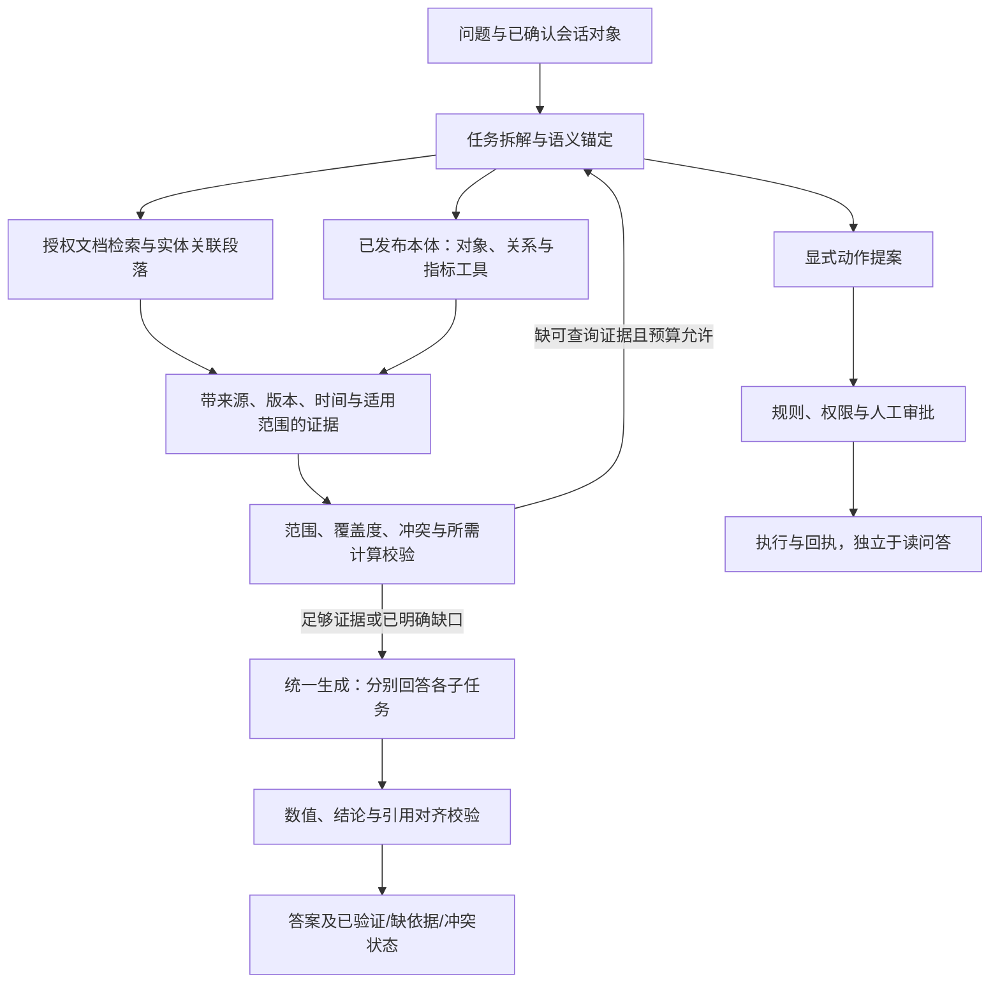

# 本体与 RAG：源码依据、实现与验收

2026-11-27。本文记录原实现诊断与设计依据，参考本地七色书及已固定版本的公开源码。当前接入的具名查询与融合生成见[本体实现状态](./enterprise_ontology_spec.md)，运行证据以[验收记录](./enterprise_ontology_verification.md)为准。

## 2026-11-27 双维度验收状态

用户澄清后，知识库验收固定为两个独立问题：**最终模型回答是否正确**，以及**生成前交付的上下文是否包含正确、充分、适用的证据**。Agent 是否会利用这些上下文、是否执行正确，不并入知识库准确率；Agent 最终答案本身仍按回答正确性单列测量。

| 指标 | RAG | RAG＋SQL | 本体＋RAG | 对照增益 / 回退 |
| --- | ---: | ---: | ---: | --- |
| 最终回答严格通过 | 26/50 | 25/50 | 50/50 | 对 RAG +24/0；对 SQL +25/0 |
| 生成前上下文充分 | 22/50 | 25/50 | 50/50 | 对 RAG +28/0；对 SQL +25/0 |
| 上下文完整且聚焦 | 1/50 | 2/50 | 26/50 | 对 RAG +25/0；对 SQL +24/0 |

[双维度逐题报告、口径和指纹](../../artifacts/enterprise-qa/2026-11-26-fusion/final-concept-answer-scope-full-50-default8/dual-evaluation-report.md)。题集是固定的 50 道单轮合成业务题，含 35 类任务。答案盲审对 50 组、150 个候选评分，1 组 Qwen JSON 键格式损坏后按原始评分值进行可追溯修补。上下文盲审对同样的 150 份实际生成输入进行评分，评审看不到候选答案，支持依据为模型输入中可核验的行编号。上下文充分定义为关键证据完整、对象/时间/版本/范围正确、所需计算正确；上下文聚焦另行衡量无关材料噪声。

本批代码指纹为 `7fbe296e…367acabd`，语义指纹为 `520aa561…632e8c8c`；答卷、答案评分和上下文评分三者指纹匹配。DeepSeek V4.1 Flash 生成答案，Qwen 3.7 Max 做盲审。题目和语料均为合成内容。该批是非流式 API，不能证明 3–4 秒首字目标；15 题保留集与 Agent 工具/动作上下文尚未按这一精确指纹完成双维度验收。

问数定义用发布查询与原始台账独立核对，采购 `settlement_preview` 覆盖 72 个输入组合。Agent 写操作之前在浏览器与隔离 HTTP 合成目标验证过提案、审批、执行、历史回读和幂等，但该结果属于动作集成，不是这 50 题的上下文能力评分。

最新相关后端回归 283 项通过。工作台/浏览器和历史回执的早先结果见[企业本体验收记录](./enterprise_ontology_verification.md)；它们不是当前双维度 50 题的额外准确率样本。

工作台、聊天动作和问答 UI 均使用实际浏览器请求；业务动作指向隔离 HTTP 合成目标，不代表接入真实目标系统或完成数据库同步。应用没有 OWL 蕴含推理器、OG-RAG 超图或 OA-RAG 的形式化 grounding 证明。

## 历史：2026-11-27 回归复盘与配套代码核对

### 实施早期的四项验收清单（当前结果已由上表覆盖）

| 范围 | 验收依据 | 当前状态与待办 |
| --- | --- | --- |
| 知识库 50 题 | 冻结的 50 道单轮题、35 类任务；每题三组同资料、模型、权限和预算 | 最新修正批次为 `grounded-contract-50-default8`，保持 8 秒规划预算；完整作答、有效盲审和技术失败分别计数。历史 35 秒预算的分数不能替代本批。 |
| 本体与 RAG 融合 | 业务身份、关系路径、规则适用、完整计算观察及原文来源同时核对 | 保留原文检索；查询结果补充实际参数，无事实的失败只留诊断。继续核对剩余错题和首字延迟。 |
| 问数 | 已发布查询的公式、日期、单位、连接关系和授权行列范围，与原始台账独立重算 | 禁止用 top-k 文本行估算全表；检查查询参数与结果一起进入生成，并验证产品入口。 |
| Agent 平台操作 | 类型化动作发现与对象绑定；预检、审批、执行、回执、持久化回读 | 工作台真实模型与真实 HTTP 合成目标已验证，拒绝、审批和幂等均保留。聊天动作卡片另行复核；合成目标不能代表外部生产系统。 |

延迟单独测实际非空 `TEXT_MESSAGE_CONTENT`；冷请求和缓存命中分开。目标沿用首字 3–4 秒，未达标如实记录。知识库验收只测当前题干完整给出的请求，不把补齐对话上下文计入能力。

### 索引入口错误与复测范围

`evidence-scope-50-mistral` 收到 150 份有效模型答卷，Qwen 审核为 27/50、30/50、44/50。但通道明细显示该批向量、BM25 未取到三个领域的数据，不能据此验收正常混合检索的准确率与速度。测试启动器把集合根名称设为了 `ragvia_ontology_chain`，它只有其他测试的 6 条记录；本批 2,629 块实际位于 `ragvia_quality_recovery_emb_b01981acc89846c8`，BM25 位于 `ragvia_quality_recovery_bm25`。

现已修正测试入口，启动前核对三个数据集在 PostgreSQL、向量、BM25 的分块数量：机场 887、IT 运维 647、采购 1,095。旧配置被预检查明确拒绝；修正后的一题三组实际调用已看到向量、BM25 候选返回。随后以原题、原始资料和相同模型重新运行 `hybrid-index-50`；新结果完成前，不把上一批当成混合检索改进成绩。该问题是测试运行配置错误，未通过放宽权限、向量空间或来源版本约束解决。

### 本体 Agent 的三条路线与本项目边界

用户补充文章的三类是工程分类，不是互斥的标准架构，也不是 OAG、OG-RAG、OA-RAG 的同义词。前一组说本体承担什么职责；后一组说 RAG 如何取证和生成，两组可组合。按文章源码核对后，本项目状态如下：

| 路线 | 本项目状态与入口 | 验收重点 |
| --- | --- | --- |
| Ontology-as-Schema（查询模式） | **已实现于已配置的数据范围。** `named_queries`、指标、对象与关系绑定发布后，模型只选择语义 ID 和参数；SQL 是预先配置并经授权范围执行的，不由模型生成。没有可用计划时常规聊天回到 RAG；未知查询、概念 ID 或不符合用户输入的参数会被拒绝。 | 检查绑定、参数、允许关系及行列权限；计算在完整授权数据上执行。它能可靠回答已建模问题，不能覆盖未登记数据语义。当前没有额外 LLM“可回答性分类器”；增加一次调用会增加延迟，而当前模型也没有任意 SQL 执行权。 |
| Ontology-as-Memory（记忆骨架） | **部分实现为融合取证，不是完整 GraphRAG。** 发布概念可绑定制度原文；对象关系证据按业务键取证；原文、向量/BM25 和本体证据进入同一生成上下文。通用 `app/rag/kg` 抽取/召回与企业本体发布定义仍是分开的。 | 保留普通 RAG，确保本体命中后仍运行文档检索；核验同一对象、有效版本和制度适用范围。尚无由企业本体约束的闭集实体/关系抽取、跨源实体对齐、社区全局摘要、OG-RAG 超图剪枝或带时间戳的 Agent 长期记忆。评测只测题干已给全的单轮知识库能力。 |
| Ontology-as-Skill-Taxonomy（能力分类） | **执行契约已实现，通用任务分类未实现。** Agent 有受调用范围约束的 `query_ontology`；发布动作定义带参数、对象、前置条件和审批要求，工作流是已配置的动作序列，继续沿审批、幂等、回执和权限复核执行。 | 动作契约验证的是“能否按权限执行”，不单独证明问答准确；平台没有把所有 Agent 任务、工具和失败语义组织成一棵通用能力本体，也没有把模型自由规划深度交给本体。 |

实现依据见 [`consumption.py`](../../app/rag/kg/enterprise_ontology/consumption.py)、[`enterprise_ontology.py`](../../app/services/chat/enterprise_ontology.py)、[`mcp_tools.py`](../../app/rag/agents/tools/mcp_tools.py) 与 [`actions.py`](../../app/rag/kg/enterprise_ontology/actions.py)。当前精确概念来源版本的 50 题为 RAG 25/50、RAG＋SQL 29/50、本体＋RAG 50/50；15 题保留集为 6/15、8/15、15/15，两批均无回退。规划器快路径只在 50 道本体题中省去 1 次规划调用，该题仍检索 8.69 秒、非流式总耗时 16.83 秒，所以这不是速度修复。来源、题目与代码指纹见验收记录。

早期相关后端回归为 256 项通过，最新按此前 277 项范围重跑并加入近期用例后为 280 项通过。独立 SQL/Python/Decimal 核算覆盖日期、去重、窗口、全量计数及付款余额。真实 HTTP 合成目标验证了正常写入、响应丢失后的回执恢复和无回执转人工核查；目标未实现知识源回写。

平台知识库标签原来误用纯结构化 `/ask`，现已改接 `/ask/knowledge`，保留原文混合检索及统一生成，问数标签继续执行结构化查询。管理入口为独立 `/ontology` 页面。真实桌面与 390px 浏览器已核对 T1、T2 两组晚点率及运行手册引用。Agentic 与并行 Agent 也复用一次本体取证和同一证据预算，不再重复规划。注册了 `query_ontology` 工具本身不能替代这些入口的验收。

### 参数、结论与延迟的最新诊断

青皮书第 60–61 页区分类型化计划、确定性计算与结果合理性检查，修正必须指出具体差异。当前一条真实失败是把用户的 `2026-11-17T10:00` 擅自改为 `2026-11-17T10:00:00+08:00`。该查询按本地时间计算恢复点年龄，不能直接放行新增偏移。参数来源校验现在加入已有的一次纠错，仍由同一个 8 秒期限管理；持续编造的值继续被拒绝。两项回归分别核对纠正后可执行及纠错后仍非法时失败。

另一条回退的计算值本身正确：结算数量 3、可付金额 300，生成却把“可支付”误解成“已经支付”，漏答额度。共用生成约束现明确区分假设计算、业务可执行性与实际执行回执。仍使用普通综合生成，没有把知识库回答改成固定模板或仅摘录原文；须由新一轮真实答卷检验，不能以提示词文字作为通过证据。

首字按非空 AG-UI 答案文本测量，排除响应头和进度。LangGraph 普通流式路径现已逐块发送实际模型内容，全文安全校验路径仍缓冲。最新已完成的旧构建三题抽测中，完整扩展配置的本体首字为 11.55、12.12、6.51 秒，仍不达标。三题精简混合检索的既有小样本中，本体首字为 5.61、7.88、4.94 秒，检索约 0.9–1.7 秒；该配置尚无完整 50 题准确性结论。

完整扩展配置一问实际运行 7 路检索，检索约 4–7 秒。因此不能再把当前瓶颈统一归因于 PostgreSQL 补召回；该批 PostgreSQL 词法兜底已因主通道候选足够而跳过。下一项比较须同时固定模型、预算和题目，验证较短检索路径的准确性，再决定产品配置，不能只用三题速度更快作为依据。

本项目目前实现了受约束查询、图文证据融合及动作契约；没有 OWL 蕴含推理器、OG-RAG 超图、完整 OA-RAG 可信度分级或通用能力分类本体。书籍演示代码的固定业务函数与规则启发了确定性计算，并不等于可直接复制成跨领域能力。不得以这些尚未实现的名称描述当前平台。

### 概念到制度来源的补齐设计

精简检索的 50 题已产生完整答卷。初步审核发现轮椅、担架、授权范围等制度问题缺少必要原文。源码中的 `read_ontology_citations` 只有具名查询来源或明确业务对象才能取证，`answer_scoped_ontology` 也丢弃没有对象的纯文档计划。现有对象表和计算目录无法表达“这条业务概念由哪份制度定义”，于是纯制度问题仍完全依赖原始向量/BM25 排序。

依照青皮书第 196 页的概念锚定与第 217–218 页的来源和预算约束，在既有发布定义中增加 `concepts`：每项包含名称、别名、说明及来源文档 ID。`QuestionPlan.concept_ids` 只能选择已发布标识。概念本身不提供答案或计算结果，只定位其授权原文；随后继续运行普通 RAG，并复用完整上下文预算和引用门槛。

取证沿用当前租户、知识库、选中文档、发布版本、处理批次及来源适用时间检查。对象问题仍按业务主键连接关系；同时选择概念时，两者证据按来源分开保留。撤回来源访问权限后，历史回答沿既有回执重新核验。空概念字段不进入旧回执摘要。

实现复用 `definition.py`、`consumption.py` 和聊天服务，不增加检索服务或新的执行器。前端高级定义可保存这份契约，问答、问数、动作三个入口保持原有职责。验收先证明无对象概念取证、文档范围和撤权边界，再比较完整扩展与精简检索的原 50 题，并加入本轮未用于改规则的 15 道保留题。

不采用假查询 `SELECT 1` 来借用具名查询的制度来源，也不把题干关键词或期望答案写入产品。逐文档文件名路由能缩小检索范围，但不能维护发布的业务词汇及其依据，因此不作为此项绑定的替代。概念来源绑定不等于 OWL 形式推理。

### 历史：35 秒规划预算的索引修正对照

`hybrid-index-50` 在已核对的索引上重新产生了 150 份单轮答卷，各组 50 份均确认向量、BM25 有候选。严格通过为文本 RAG 29/50、RAG＋SQL 29/50、本体＋RAG 48/50；对两个对照组均新增答对 19 题、回退 0 题。49 题为有效 Qwen 盲审，1 题经三次矛盾判分后由 Codex 对照原文裁决：SQL 答案把另一座登机桥的交接记录作为当前工单的补充证据，事实分从 2 降为 1，原始记录及裁决理由均保留。未修改题目、业务真值或答卷。[同题报告](../../artifacts/enterprise-qa/2026-11-26-fusion/hybrid-index-50/report.md) · [裁决记录](../../artifacts/enterprise-qa/2026-11-26-fusion/hybrid-index-50/grading/adjudications.json)

此前 `grounded-context-50`、`grounded-context-50-single-turn` 和 `evidence-scope-50-mistral` 的最后一问通道明细均为 150 份中 0 份有向量或 BM25 候选。它们保留为当时错误配置下的原始实验，不能继续引用为正常混合检索成绩。`hybrid-index-50` 是索引修正时的历史对照，当前修正需使用各自冻结的新批次验收。

完整答复 P50/P95（秒）为 23.86/37.01、23.71/38.17、26.34/48.26。另以单客户端对三道冻结问题各测初次流式和重复流式，共 18 次有效请求；首字中位数分别约 16.27、17.93、19.41 秒，均未达到 3–4 秒。未命中答案缓存，嵌入和候选缓存关闭，底层数据库与向量库已经历前序查询；这不是生产暖缓存验收。QA 规划上限为 35 秒，产品默认上限为 8 秒，正式部署还需按默认预算复核。修正索引并没有解决串行扩展、重复检索和在线规划耗时。

两道剩余错题指向不同缺口：停用登机桥的关联待保障航班缺少覆盖该请求的已发布查询，普通片段被误作全量清单；工单 1105 三项材料字段均为 1，生成仍误用状态标签和另一座桥的交接信息否定完整性。需要补齐可配置的业务口径、关系锚点和结论约束，再在同题与未用于修正规则的题上验证。

Agentic 与并行 Agent 现已按原始完整问题准备一次本体证据，子查询复用同一回执，生成接入共用预算；完成事件保留动作提案，指标保留取证回执及诊断，使持久化入口能加密并在历史回读时复核权限。四项新增行为测试先复现失败，再修复；连同相关流式路径 52 项回归通过。Milvus 的两类检索入口也将“集合不存在”与“正常查询无匹配”区分，缺失索引不再返回成功的空结果；相关 94 项回归通过。Agent 的真实模型、页面动作以及管理页融合入口仍需继续联调，不能用这些离线回归代替验收。

### Agent 真实模型联调与多组参数修正

真实引擎联调先暴露了测试替身掩盖的旧依赖：Agent 调用已从 `RAGEngine` 移走的 `_doc_key`、`_prefer_doc`。已改为直接调用实际所有者 `document_key`、`prefer_document`；回归夹具使用真实的 `chunk_id`、`score`，不再用只在替身上存在的字段和方法证明通过。

继续联调时，完整问题要求分别核算 T1、T2，旧计划契约只有“查询编号 → 一套参数”，两种 Agent 都只选择了 T1。单纯增加提示没有修复，失败记录保留。现在同一查询编号支持一套参数或多套参数，每套分别进行用户值溯源和授权查询，结果保留实际参数，证据记录编号包含参数摘要；整个请求仍最多执行六次具名查询，沿用原有执行上限。历史单套参数的 90 份回执重新核算仍全部一致。独立原始台账计算和评测也支持逐套参数，不把第一套当作全部请求。

对原问题重新调用真实 Mistral DeepSeek，单 Agent、并行 Agent 均只规划一次，实际使用 T1、T2 两套参数，生成上下文中两份查询观察各有独立编号且都入选。核算结果为 T1 晚点 76/100（76%）、T2 晚点 77/95（约 81.05%），与只读原始台账核算一致；原文、预算、回执保护和模型调用检查均通过。[真实功能记录](../../artifacts/enterprise-qa/2026-11-26-fusion/agentic-ontology-batch-35/responses.json)

这项功能对照使用与前述 50 题相同的 35 秒测试规划预算，首字约 11.92、19.75 秒，不能称为生产延迟通过。默认 8 秒预算的探测出现过规划超时，记录在 `agentic-ontology-live`；测试脚本遗漏结果出站配置时的拦截记录也单独保留，未算作成功。本轮没有增加产品默认超时。管理页融合入口、真实页面动作以及默认预算的完整联调仍待完成。

当前相关后端回归为 307 项通过，前端同步了 OpenAPI 生成契约，补齐一个已有诊断测试夹具的必需字段。TypeScript、13 项相关 Vitest、类型漂移门禁、所改测试的 ESLint/Prettier 已通过。新增批量参数契约尚未重新运行完整 50 题，之前 48/50 对应已存档的对照版本；下一轮应在延迟修正后用相同题目和预算重新核验，再另用未参与调规则的问题检查泛化。

接下来的实现顺序：先按实际阶段耗时并行独立本体取证和普通检索，保留独立会话、请求上下文和取消回收；消除单 Agent 转并行 Agent 时重复的任务分解，按现有预算减少重复查询。随后补齐登机桥关联待保障航班的允许路径和具名查询，以及本单材料与状态标签的判定边界。不得靠扩大默认超时、把进度事件算成首字、改参考答案或跳过原文检索达标。

1,000 题评测记录了纯 RAG 通过、本体组未通过的 97 例。其中 52 例在 RAG＋SQL 组也通过，有 49 例同时满足两个对照组通过且本体组实际加入了本体证据。第三组同时开启普通 SQL，因此这 49 例最适合优先追查本体证据如何改变了答案。各组的真实作答和评分可逐题定位。[97 例回归记录](../../artifacts/enterprise-qa/2026-11-26-fusion/regression-audit-97.json)

在隔离库重放了 90 份本体执行计划，90 份证据摘要与保存记录匹配，其中 48 份返回了具名查询结果。摘要会剔除部分运行时字段，时间字段参与生成的情况另行复现。原评审给出了 73 个无依据断言标记和 40 个自相矛盾标记，同一题可带多个标记。这轮按可独立重算的事实和可回读的证据复核了代表样例，正式分数仍需按统一判据复评。[97 例回归记录](../../artifacts/enterprise-qa/2026-11-26-fusion/regression-audit-97.json)

| 样例 | 复核结果 | 受影响的环节 |
| --- | --- | --- |
| 采购单-5332 | 同版本的 `supplier_eligibility` 查询实际返回 `qualified_on_order_day=1`。下单日为 11 月 7 日，资格截止日为 11 月 8 日，两张原始表也独立支持结论。原评分因证据摘录中没有该派生字段而把它扣为编造。 | 评测要同时校验独立业务真值和答案引用的实际证据。 |
| 机场维修-1123 | 工单关联 T1 东区 6 号登机桥，答复附加的 09:10 完工消息和周岚放行记录属于 7 号桥。交接文档及该段文字都真实存在。 | 证据需要绑定当前工单与设备，真实文档也可能引用到另一个对象。 |
| CF6185 | 纯 RAG 的引用包含旅客餐宿规范，本体组的最终引用缺少该规范并答复资料不足。原始语料可核实天气和餐宿适用条件。 | 已定位到证据缺口。现有记录保存了最终引用，本体计划和结果也可回放。精确定位丢失发生在召回、排序或上下文组装，需要记录进入生成的证据清单。 |
| 变更-4102 | 具名查询返回普通变更、`in_freeze_window=0`，紧急材料字段为空。正文承认 15:02 在冻结时段外，开头却称时段不满足。答复还把缺安全审批和未演练作为普通变更的阻断项。 | 生成前要确定规则适用性，生成后要核对结论与计算字段的一致性。 |
| 服务单-2520 | 调用 `prepare_ontology_evidence` 的本地复现中，真实恢复时间 11 月 16 日和文档更新时间 `source_updated_at` 11 月 26 日一起出现在 `object`、`rule.evidence`。保存的答复把文档更新时间当作业务快照异常。 | 事实有效时间、事件时间和文档更新时间要各有语义，业务判断只读相关时间。 |

首轮回归版本把本体对象和规则结果序列化为 JSON，把本体文档放到 `tag_docs` 前面，生成阶段再把 JSON 加在原文上下文前。关键验证点是每个子问题的证据能否满足业务对象、制度有效期和适用范围，并保留原本可用的文档证据。后续第一批实现及其试验结果见下文。[证据组装](../../app/services/chat/enterprise_ontology.py#L199) · [检索合并](../../app/rag/retrieval/orchestrator.py#L95) · [生成上下文](../../app/rag/runtime/graph/generation.py#L89)

三个典型回归样例的运行指标显示 `claim_check_enabled=false`。另用同一条交货宽限规则构造数字核验，默认 `token_overlap` 检出 3 天与 7 天冲突后仍判支持，`strict` 模式在这项核验中拒绝 7 天并接受 3 天。可复用现有声明校验入口承接经核实的数值和条件，优先避免以词面重合决定结论。[生成校验入口](../../app/rag/runtime/graph/answers.py#L66) · [声明核验器](../../app/rag/safety/claim_verification.py#L186)

### 配套源码可直接对照的机制

- 青皮书第 225–226 页的 `graphrag_pipe.py` 从锚点沿允许的关系遍历，检查必需边和属性，再把受约束子图交给生成。示例的字段集合检查需要在 Ragvia 收紧到同一业务对象、同一时间范围和可核实原文。第 218 页给了可选属性、条件约束及退回文档检索的处理，适合用于语义约束覆盖不足的问答。[青皮书 PDF](</E:/learning/本体论五色书/【老刘说社区内部资料，侵权必究】刘焕勇.本体论五色书系列/五色书配套PDF/【青皮书】刘焕勇.⽼刘说NLP 技术社区.本体论驱动⻘⽪书.pdf>)
- 金皮书第 10 章代码 10-2 把实际召回片段与标准答案分别送入评测，代码 10-3 对数字对账运行专项门禁。Ragvia 的 `make_packet` 目前给评审的是题库摘录和候选文本。评审工作需要能够核查匿名候选实际引用的来源和独立验证过的查询派生值。[金皮书第 10 章配套代码](</E:/learning/本体论七色书/【老刘说社区内部资料，侵权必究】刘焕勇.本体论五色书系列/五色书配套代码/知识工程金皮书/第10章_评测体系与数据飞轮：如何证明数据与知识库是高质量的>) · [评审输入](../../artifacts/enterprise-qa/2026-11-25-realistic/grade_full_run.py#L145)
- 黑皮书配套源码 Graphiti 的实体关系分别记录事实生效、事实失效和系统记录时间。红皮书第 26 页给规则配置 `ValidFrom`、`ValidTo`、适用范围、对象和原始条款。七色书本地 Demo 用纯函数固定计算逻辑及证据输出，已运行四项函数测试。[Graphiti 时间字段](</E:/learning/本体论七色书/【老刘说社区内部资料，侵权必究】刘焕勇.本体论五色书系列/黑皮书开源项目代码/opensource_codes/getzep__graphiti/graphiti_core/edges.py:271>) · [红皮书 PDF](</E:/learning/本体论五色书/【老刘说社区内部资料，侵权必究】刘焕勇.本体论五色书系列/五色书配套PDF/【红皮书】刘焕勇.⽼刘说NLP技术社区.本体论规则引擎红皮书.pdf>) · [本地 Demo 函数](</E:/learning/本体论七色书/本地Ontology-Demo/backend/app/core/functions.py:9>)

### 修复验收用例

1. 组合证据前校验对象、业务有效时间、规则适用性以及原文或计算来源。对落在适用范围外的本体观察保留文档检索结果，CF6185 应保住餐宿制度，1123 应排除 7 号桥的交接记录。
2. 把已验证的计算和适用性结果用作结论约束。4102 的普通变更与冻结状态、5337 的一天日期差进入确定性检查，2520 的文档更新时间走审计字段。
3. 让评审分别核查答案正确性和论断证据。用相同资料、模型与检索条件对照 RAG＋SQL 和本体组，再在未用于调规则的题上检查新增答对与从对变错的数量。

### 问答代码走查

- 模型给出的查询编号现在通过已发布目录校验。目录外的编号沿用规划失败处理，普通问题继续走文档检索。绑定对象的查询参数要求完整编号，`PO-2` 与 `PO-20` 能区分。[规划检查](../../app/rag/kg/enterprise_ontology/consumption.py#L707)
- 执行层保留已提供的不同对象编号，用主对象编号填补缺失参数，并转换已经解析为该主对象的显示名。隔离库重放的 90 份回归计划和 19 份显示名查询计划全部与原摘要吻合。[参数绑定](../../app/rag/kg/enterprise_ontology/consumption.py#L1065)
- 出现制度来源缺失时，证据组装同时移除该具名查询的结果和仅供它使用的制度片段。其他可用查询的共享制度片段继续供其引用。[证据准入](../../app/services/chat/enterprise_ontology.py#L261)

上下文预算复现用的是现有的 12,000 字符文档限额。输入 7 个普通片段时，目标制度进入模型上下文。添加一个排在前面的本体片段后，目标制度在代码截断处被漏掉。流式路径还会把本体 JSON 加到已截断的文档上下文之外。这个复现确认了两路证据的预算和顺序会改变最终输入。CF6185 的原始生成入参仍需完整证据日志才能定位具体丢失位置。[文档上下文](../../app/rag/runtime/graph/context.py#L16) · [流式合并](../../app/rag/runtime/streaming/evidence.py#L697)

## 七色书与主流代码对应的改造方案

2026-11-27 核对本地青、红、黑、金皮书相关章节及七色书目录内的配套代码，同时读取 Microsoft GraphRAG、LlamaIndex Property Graph、Neo4j GraphRAG 的公开源码。下面记录采用机制和对应改动，实施进度以回归与真实链路验证为准。

本轮验收采用单轮知识库问答。题干给出业务对象和用户已知条件，每个请求的历史消息为空，评测文档检索、对象与关系定位、规则适用、计算、答案证据对齐及耗时。下文的上下文预算指实际送入模型的知识库证据。原 50 题中的两道历史依赖题已改写为独立问题，改写来源和复用的 48 道单轮记录在协议中可核对。[单轮验收协议](../../artifacts/enterprise-qa/2026-11-26-fusion/grounded-context-50-single-turn/single-turn-protocol.json)

### 第一批实现与试验结果

普通和流式本体问答已接入同一个 `build_grounded_context`。本体证据在原文排序后加入，组装时为两个证据来源保留初始等份预算并分配剩余空间。沿用原有字符或 token 上限，整份结构化观察和查询结果一起入选或剔除，查询要求的制度来源也检查是否入选。每项候选记录来源 ID、版本、对象标识以及入选状态。返回引用取自已通过原有门槛且实际进入上下文的来源，新增诊断记录加密持久化并在会话回读时校验访问权限。[共用组装器](../../app/rag/runtime/graph/context.py#L93) · [试验记录](../../artifacts/enterprise-qa/2026-11-26-fusion/grounded-context-trial-v2/report.md)

选择六道已知问题进行同通道三组试验，Mistral DeepSeek 产出 18 条有效作答，Qwen 按完整授权制度原文和独立台账计算复核，三个组各严格通过 3/6。本体问答上下文为 4,716–5,727 字符，上限为 12,000 字符。三条单独的本体流式请求正常结束，六条本体回答及其诊断记录通过会话回读。试验保留代码指纹和原始答卷，评分依据在 `review-protocol.json` 中记录。

这次登机桥回答正确区分了材料与状态，供应商资格和变更时窗也通过盲审。餐宿题的目标制度仍未召回，服务单把已验收误判成不能进入关闭流程，交货题仍出现开头结论与一天日期差相反。这些结果将后续工作指向概念到制度的检索、规则适用性和结论对账。该定向试验用于暴露缺口，全题库的准确率与延迟改善仍待同条件复评。

### 延迟与已有正确答案的验收

原 50 题混入了两道历史依赖题，原始记录保留供核对。将这两题改成独立完整问题后重新运行和审核，单轮口径三组严格通过数为 28、27、42，相对纯 RAG 新增答对 16 题，回退 2 题。其余 48 道已有单轮记录复用，代码、模型通道、资料及配置指纹已核对相同。这里的分数变化来自题目形式修正。完整响应 P50 为 14.37、13.96、17.02 秒，首字目标需要独立的流式测量。[单轮 50 题报告](../../artifacts/enterprise-qa/2026-11-26-fusion/grounded-context-50-single-turn/report.md)

青皮书第 57 页通过离线构建语义层缩短在线路径，第 196 页列出常规查询路径缓存，第 213 页把证据对齐、幻觉和延迟一起评价，第 218 页列出可选属性、条件约束和退回原文检索的处理。这几项在当前代码中的衔接还需完成。

- 原批次含前置消息，共执行了 52 次本体规划调用。这说明了每个请求都有规划开销，验收只采用当前问题完整给出的单轮口径。`run_retrieval` 等待规划和取证完成后，才运行普通检索。应让已发布词汇、业务身份、固定计算和允许关系承担可本地执行的判断，按知识库任务需要安排模型规划，独立的检索工作并行执行。[当前前置调用](../../app/rag/retrieval/orchestrator.py#L80)
- 可结算金额那道回退题给出了完整假设输入，却规划了缺少订单编号的 `order_settlement` 查询。进入最终模型的本体部分只有缺参数提示，并无该查询结果。答复随后混淆了本次可申请支付额度与实际付款流水，且算错减法。证据准入应保留有实际依据的规则和计算，缺参提示留作诊断。查询失败也需要判断是否影响当前子任务，避免扩大为整题无法回答。
- 日期比较那道回退题已有交期和验收日期，却把“比较两个日期”扩大为“认定真实到货违约”。需要分别建模日期差计算、宽限条件和实际履约认定，使缺少实际到货证据只影响对应结论。规则的适用范围和计算结果应在生成前明确。

后续采用同题验证已有正确答案能否保留，逐题检查新增回退，完整响应及首字耗时分别报告，并区分冷请求与缓存命中。沿用用户提出的首字 3–4 秒目标检查真实 `TEXT_MESSAGE_CONTENT` 事件。规则与路径缓存需要带发布版本及调用范围，查询执行继续核验当前权限和数据。当前保留原文与本体两路预算只是其中一项改动。

### 1. 先把证据和上下文预算接完整

青皮书第 217 页明确要求限定相关关系、裁剪结果并设置 token 预算，第 218 页要求检查图与原文版本。GraphRAG 的 `LocalSearchMixedContext.build_context` 扣除会话预算后，给社区摘要、实体关系和原文片段分配剩余预算。`_build_text_unit_context` 使用命中实体的 `text_unit_ids` 找来源片段，候选记录可以标记 `in_context`。这些机制对应 Ragvia 已复现的两路证据争用预算及上下文外追加本体 JSON。[GraphRAG 预算分配](https://github.com/microsoft/graphrag/blob/bc7c828d23f50f030f048eaf6d2b3ebe5e537958/packages/graphrag/graphrag/query/structured_search/local_search/mixed_context.py#L164) · [来源片段与入选记录](https://github.com/microsoft/graphrag/blob/bc7c828d23f50f030f048eaf6d2b3ebe5e537958/packages/graphrag/graphrag/query/structured_search/local_search/mixed_context.py#L306)

Ragvia 的具体改动应从现有 `OntologyEvidence`、`BusinessObject`、`NamedQueryResult` 和 `OntologyCitation` 出发。查询结果和对象事实保持完整单元，原文按来源片段去重。普通与流式生成使用同一份预算结果，同时记录入选 ID、来源版本、裁剪原因和实际 token。原文与本体证据各有保留空间，预算比例通过回归集确定。权限在候选进入预算计算前校验。

验收覆盖不同长度、重复来源、同名对象和预算溢出。保留下来的每个数值都能读回其整行计算结果与适用制度，原文条款能读回文档版本及片段。对 CF6185 类问题检查餐宿条款是否入选，对全部路径检查合并后的实际 token。

### 2. 通过业务身份和来源连接图事实与原文

青皮书第 198–199、225–226 页的骨架先锚定实例，再沿声明关系取证并校验。LlamaIndex 的 `BasePGRetriever` 给三元组保存 `TRIPLET_SOURCE_KEY` 对应的来源节点，`add_source_text` 回取节点原文。`SchemaLLMPathExtractor` 在严格模式下校验主语类型、关系、宾语类型组合。Neo4j 的 `HybridCypherRetriever` 先得到向量及全文检索候选节点，再从该 `node` 执行声明的关系查询。[LlamaIndex 来源回读](https://github.com/run-llama/llama_index/blob/40d4f79eb9d8f68430692d0cc156483ca2d7f4f6/llama-index-core/llama_index/core/indices/property_graph/sub_retrievers/base.py#L53) · [抽取类型校验](https://github.com/run-llama/llama_index/blob/40d4f79eb9d8f68430692d0cc156483ca2d7f4f6/llama-index-core/llama_index/core/indices/property_graph/transformations/schema_llm.py#L325) · [Neo4j 从命中节点扩展](https://github.com/neo4j/neo4j-graphrag-python/blob/544cd945449e1f2f608ad7c40dcc18e8faa0c92f/src/neo4j_graphrag/retrievers/hybrid.py#L286)

Ragvia 已有租户、对象类型、业务主键、版本化绑定和原文证据跨度，多跳路径也已有身份连接检查。下一步应让进入生成的事实携带这些标识，并在工单、设备、制度之间验证关系路径。片段包含另一对象时，只把有路径支持的事实用于当前对象。无主键的制度解释仍按制度作用范围取证。

验收使用同名设备、同供应商不同设备、一个片段含多台设备、断开任一中间关系、原文版本变化等输入。机场维修-1123 的 6 号桥和交接记录中的 7 号桥需要分别得到身份及证据归属。可复用现有 `_path_citations` 和 `grounded_citation` 承担校验。

### 3. 把制度适用性纳入规则执行

红皮书第 26、155 页给规则配置适用对象、范围、有效期、来源条款、例外及覆盖关系，并在规则发布前检查冲突。黑皮书第 133 页和配套 Graphiti 源码区分事实有效时间与系统记录时间。青皮书第 60 页给固定业务口径采用中间表示与确定性执行的路径。[Graphiti 时间字段](</E:/learning/本体论七色书/【老刘说社区内部资料，侵权必究】刘焕勇.本体论五色书系列/黑皮书开源项目代码/opensource_codes/getzep__graphiti/graphiti_core/edges.py:271>)

当前 `RuleDefinition` 只有对象类型、条件和标签，制度作用范围与例外大多仍在具名查询 SQL 或描述文本中。应将已核实制度的适用性放入规则定义及执行结果，先判断适用，再计算通过、未通过或证据不足。普通变更的安全审批问题、区域专项时限、新旧制度和未知字段应通过这套执行语义处理。缺失依据的部分明确返回待核实。金额、日期、工作时间及阈值由现有查询或函数计算。[当前规则定义](../../app/rag/kg/enterprise_ontology/definition.py#L250) · [当前执行结果](../../app/rag/kg/enterprise_ontology/behaviors.py#L28)

验收改变同一对象的事件日期、区域和类别，检查规则命中、例外覆盖和原始条款。变更-4102 的时窗与普通变更条件应分别对账，专项制度的优先级应有业务来源。

### 4. 用证据 ID 核对答案中的结论

GraphRAG 的生成提示用来源表及记录 ID 引用论断。青皮书第 60–61 页将口径、执行和结果合理性分层验证，第 226 页要求答案与证据对齐。Ragvia 可以复用已存在的结构化输出和声明校验入口，让数值、对象、适用规则及引用 ID 可核对。发生冲突时，输出由已核实字段支持的结论，或在既有调用预算内进行一次有明确差异说明的修正。[GraphRAG 引用契约](https://github.com/microsoft/graphrag/blob/bc7c828d23f50f030f048eaf6d2b3ebe5e537958/packages/graphrag/graphrag/prompts/query/local_search_system_prompt.py#L18) · [Ragvia 声明校验入口](../../app/rag/runtime/graph/answers.py#L66)

验收包括计算正确而标题错误、适用条件与结论相反、引用另一对象、空结果和真实零值。默认词面重合校验会接受已检出的数值冲突，这项复现应纳入生成门槛。开放式解释还需语义审核与业务抽查。

### 5. 按金皮书把判分证据补齐

金皮书第 78–79 页及配套代码 10-2、10-3 要求同时保存问题、答案、实际检索上下文和独立真值，分别测正确性、忠实性、相关性及数字对账。GraphRAG 的 `context_records` 为这类归因提供实际入选记录。现有题库摘录继续作为独立参考，实际上下文用于查证候选所引用的事实，派生值用独立原始台账计算核对。[金皮书评测配套代码](</E:/learning/本体论七色书/【老刘说社区内部资料，侵权必究】刘焕勇.本体论五色书系列/五色书配套代码/知识工程金皮书/第10章_评测体系与数据飞轮：如何证明数据与知识库是高质量的>)

先重放已确认缺陷的固定用例，再在保持题库、权限、模型和调用预算一致的条件下做三组评测。记录新增答对、从对变错、缺失必要证据、无依据断言、首字 P50/P95 和实际调用成本。此前两批使用不同 DeepSeek 通道，后续保留各批明细并用统一通道复评可比样本。

实施从第 1、2 项开始，每项同时覆盖普通与流式入口。书籍提供机制和教学骨架，公开项目提供对应实现。上述项目级接法还需在 Ragvia 的权限、数据契约与测试条件下验证。

## 初版实现的诊断

当前实验组应解释为“本体优先短路的原始实现”，不能作为正确的本体融合架构与 RAG 的公平对比。本体返回任意 `OntologyChatTurn` 后，普通聊天直接构造响应，流式聊天发完本体结果即结束。对象字段、候选指标、无结果提示乃至仅覆盖子任务的规则结果都会阻断后续 RAG 检索和生成。

问题不只在提前返回。测试领域定义大多由物理表生成对象类型、通用计数及少数规则，没有完整表达晚点率的分子分母、事件日与制度版本、适用设备类型、区域专项、SLA 工作时间或付款计算。因此需要同时修正领域知识构建、查询执行和证据综合，不能只删除 `return` 后把两段答案拼进提示词。

前轮评测已揭示当前实现失败，不能据此宣称本体方法无用，也不能把论文的正向结果当作项目上线保证。[全量记录](../../artifacts/enterprise-qa/2026-11-25-realistic/full-reviewed-v2/report.md)保留全部回答、初评和评分纠错。该题库只有 35 类任务与 965 个场景变体，评测语料为模拟资料。

## 青皮书实际要求什么

本次阅读的是本地 341 页 PDF 版《本体论驱动青皮书》，重点核对第 1、2、5 章与第 7、8 章相关段落。第 57、196 页架构图另从原 PDF 渲染检查。页码使用 PDF 页面号，与书内页脚一致。原文件路径保存在研究证据目录的 `greenbook-source.json`。

| 页码与章节 | 原文机制 | 对本项目的要求 |
| --- | --- | --- |
| 第 8–9 页，1.1.4–1.1.5 | 动作能力清单、前置条件、权限与审批形成确定性执行闸门 | 本体约束真实动作；生成建议不能代替审批、执行回执或同步完成 |
| 第 56–61 页，2.1.4–2.1.6 | 本体连接语义解析、上下文组装、SQL 生成与口径校验；维护同义词、指标公式、维度和 JOIN 路径 | 查询从业务定义落到授权数据，统计不能对 top-k 文本记录估计全表；时间、单位、适用域必须显式 |
| 第 195 页，5.1.4.1 | OAG 三派所检索的对象不同：业务实例、文档事实块或压缩后的 schema | 业务语义层、OG-RAG 超图、OWL 逻辑推理不能互相冒充 |
| 第 196–200 页，5.1.5–5.1.6 | 概念检索、实体锚定、受约束遍历、子图校验、生成 | 本体组织和约束证据，仍要综合回答；不能把查询命中直接当整项任务完成 |
| 第 202–203 页，5.1.8 | 图质量、概念映射和版本漂移会导致错误；本体是检索形状约束，并非终点 | 有关、完整、真实、适用是不同检查；模型整合正确数据仍可能计算或表述错误 |
| 第 213、216–218 页，5.1.15–5.1.20 | 检查证据对齐、幻觉、关系路径、缺证据、成本与延迟；处理约束误杀和图文不同步 | 同题关闭/开启约束，保留必要证据召回和无依据结论拒绝；不能只统计接口 200 |
| 第 219–226 页，5.2–5.3 | 建模允许边、适用类型与子图形状；通过工具查询；示例可用 JSON/dict 表达 | 可先复用现有类型与关系契约，不能为贴论文名称强换存储；现有校验也不能伪称 SHACL 或 OWL 推理 |

书中示例是方法说明，不能原样当作规范实现或行业事实。第 223–226 页的演示明确不接 LLM；图形结构校验通过只证明声明的字段或关系具备，不证明原始事实真实、更不证明最终自然语言结论必然成立。安全、医疗、消防等规则须另外依据权威业务来源确认。

## 三个名称和三个相关工作的边界

OAG 是本体增强生成的宽泛工程方向，不是一个所有论文共同遵循的统一协议。OG-RAG、OA-RAG 是不同具体方法；AutoOntologyBench 是评测基准，OGDA 是面向异构数据湖的数据 Agent。可以把它们一起研究，不能称为同一 OA-RAG 框架的三个实现。

| 工作 | 输入与机制 | 输出与可迁移点 | 不能声称什么 |
| --- | --- | --- | --- |
| OAG | 用对象、语义定义、关系、规则和来源辅助生成或工具执行；实现因产品而异 | 业务语言到数据资产的语义接口；确定性计算与动作治理 | 不是一加本体就保证答对，也不强制每问图查询优先 |
| [OG-RAG](https://arxiv.org/html/2412.15235v1#S4) | 先按领域本体将文档映射为事实块，再构造超图；检索相关节点，以覆盖目标选择紧凑超边集合 | 保留多元事实之间的联系，将检索事实交给 LLM 生成；第 4.2.3 节明确有最终生成步骤 | 不是普通实体图加分即复现；检索的贪心覆盖也不能扩展为任意图上的全局最优保证；方法本身不是 OWL 蕴含证明 |
| [OA-RAG](https://arxiv.org/html/2610.36335v1#S4) | 预工具推理、同一对话内有预算的 ReAct 查询；概念卡、名称链接、SPARQL 与本体推理器；空 SELECT 可用概念卡 BM25 候选继续探索 | 过滤失败/无信息观察，再生成答案；冻结答案后给证据和 grounding 等级 | `entailed/supported/related/unrelated` 是模型对答案支持程度的判断，不是对整段答案的机器证明；`Not Entailed` 在开放世界下不等于 false |
| [AutoOntologyBench](https://arxiv.org/html/2611.27734v1#S4.SS2) | 对照 Direct、RAG、原生 DSL、本体、本体＋RAG；冻结工具、执行器和预算；专家语义层作有额外知识的上限参照 | [第 4.3 节](https://arxiv.org/html/2611.27734v1#S4.SS3)以来源原生执行器判任务完成；分离知识构建质量和运行时收益 | 不是 OA-RAG 的一次复现，也不是用另一个 LLM 打分就等价；论文平均增益不保证每个域或每一道题都更好 |
| [OGDA](https://arxiv.org/html/2611.12114v1#S3.SS2) | 从数据和文档构造 schema 与语义对应；提议者提出假设，验证者查底层数据；运行时先观察语义，再把来源加入任务图 | [第 3.3 节](https://arxiv.org/html/2611.12114v1#S3.SS3)约束计算只访问已落地的任务来源，结果保留数据处理血缘 | 不是看了本体描述就验证了全部事实；公开 README 还明确概念、链接和经验是指导，不能全部当独立验证的事实 |

OA-RAG 的本体推理服务验证特定类包含或关系查询；最终回答仍需要证据综合。论文在空证据时允许使用模型参数知识，但企业私有事实场景不能照搬为猜测私人业务数据，应保留“缺依据/未验证”的状态。

AutoOntologyBench 报告本体＋RAG 相对 RAG 平均增加 6.1 个百分点，仍低于专家参照 13.0 个百分点；第 5.5 节也列出部分域的小幅负增益。它证明的是在论文条件下结构化语义有可测收益、建模质量影响上限，并没有证明组合能力逐题严格包含原 RAG 的正确结果。

## 初版代码的具体缺口

| 位置 | 已有能力 | 本轮确认缺口 |
| --- | --- | --- |
| `app/api/v1/conversations/routes.py`，`ask` 调用本体后的分支 | 发布版本、文档范围和结果持久化 | 非空本体结果即直接响应，RAG 请求准备与生成还未执行 |
| `app/services/chat/stream_orchestrator.py`，本体分支 | AG-UI 流输出及本体回执保护 | 发出本体文本后 `return`，同样截断检索生成 |
| `app/services/chat/enterprise_ontology.py` | 发布绑定、对象、指标、规则、动作提案、引用与权限回读 | 常规入口只传当前问句，没有向本体规划器提供会话对象历史；有计划不等于满足整项问题 |
| `app/rag/kg/enterprise_ontology/consumption.py` | 类型化计划、允许的具名指标/关系/规则、授权查询和模板回答 | 计划以单个指标/规则为中心；缺少组合任务完成判断；“找不到对象”“选指标”也被当终局答案 |
| `app/rag/kg/enterprise_ontology/definition.py` 与 `behaviors.py` | JSON/Pydantic 业务定义、属性比较规则、统计函数、来源绑定 | 不是 OWL 类公理推理器，Pydantic 通过不等同 SHACL 检索子图验证；不能用 `entailed` 包装为形式证明 |
| `app/rag/agents/tools/mcp_tools.py`，`query_ontology` | 已有受权限约束的本体工具，可返回查询结果或待审批动作提案 | 常规聊天的本体前置分支先截断了主流程；注册过工具并不证明采用了 OA-RAG 的取证循环 |
| `app/rag/retrieval/stages/knowledge_graph.py` | 图谱命中文档块注入、路径元数据与排序特征 | 与企业本体前置问答是不同链路；已有 KG 注入不等同领域指标/规则真正参与统一任务 |
| `freeze_ontologies.py` 与三份测试领域定义 | 从来源表配置对象绑定、计数/合计、少量规则 | 缺少关键业务口径、复杂计算、适用时段/对象/区域及语义映射验证；“桥恢复材料”不能泛用于泵，“紧急审批”不能套普通变更 |

本轮直接查询工单返回 200 且数据齐全、支付组指标返回 90，自然语言计划却漏对象键或未选指标。证据在 [规划诊断](../../artifacts/enterprise-qa/2026-11-25-realistic/full-reviewed-v2/ontology-planning-diagnostics.json)。这是规划和衔接问题，不能解释为原始业务数据不存在。

这些能力可以复用：租户/文档权限、发布绑定、快照、关系来源、指标执行、动作审批与幂等回执。它们不应因聊天短路有缺陷就全部推倒重建，也不应被包装成已经实现完整的本体推理融合。

## 拟采用的改造方向

这是基于原文的工程提案，不声称已落地，也不声称复制了任一论文的全部方法。

1. **先修任务语义，再接融合。** 对象名称、别名和业务主键映射到来源字段；带上真实会话对象；区分明细、全表统计、规则解释、跨文档关系和写动作。多项明确需求应组合执行，不能要求用户在本来就都要用的指标之间二选一。
2. **领域定义承担可验证语义。** 定义公式、过滤、时间、单位、连接路径、适用类型及文档版本；逐个用真实来源读回验证。按来源和覆盖缺口返回 unknown，不把没有命中当作事实 false。高频数值/日期/工作日计算由已验证查询或代码执行器负责，不能让 LLM 自由心算。
3. **RAG 与本体共享任务和证据。** 文档分支可以受本体概念和允许关系引导；本体提供结构化事实和规则结果。两条分支不是必须每问都跑，也不是无条件合并全部候选。只回答已被证据覆盖的子任务，保留不适用、过期、冲突与来源缺失的区别。
4. **必要时进行有预算的工具探索。** 利用已有 Agent 工具，在确实缺可查信息时继续查对象、关系或原文；限定轮数、调用数、时间和数据范围。单次可回答的问题不强制 ReAct，避免把 3–4 秒目标变成每问多轮推理开销。
5. **统一生成与结果校验。** 数值引用执行结果，规则引用对应版本、适用域和事实；论断必须能回到具体原文或计算。生成后检查是否回答全部子任务及是否自相矛盾。“有若干引用”不是完成标准。
6. **动作治理单独保留。** 不因读问答证据不全放宽执行权限或审批；模型只能提案，真实写入仍走前置规则、授权和幂等回执。

不先引入通用 OWL 推理服务、全新图数据库和完整 OG-RAG 超图栈。应先用一个有业务语义的切片证明收益；若需求明确需要类公理蕴含、复杂多元事实原子性或跨数据湖探索，再评估对应方法和实际依赖。没有引入某个组件就不能宣称已经实现该组件对应的论文能力。

## 从哪里证明“本体确实有用”

先选当前系统有明确失败、且原始数据可验证的任务，而不是围绕内部本体字段出题：

| 业务切片 | 纯 RAG 的已见失败 | 本体应新增的实际能力 | 独立判据 |
| --- | --- | --- | --- |
| 航班晚点率 | 把若干召回行当全表数据 | 航站楼关联、取消/调机排除、15 分钟含等号、分子分母全量计算 | 原始表授权 SQL 与独立计算，不靠模型背数字 |
| 到场时限复核 | 找到工单却缺区域、专项或事件日适用规则 | 工单→设备类型/区域→适用制度→连续时间计算 | 同一事件改变区域、日期、设备类型的反事实核对 |
| 采购可付金额 | 质保金重复扣留、混淆已审批与实付、漏跨表字段 | 订单/验收/发票/付款身份关联、未结数量、金额上限、一次扣留 | 小数货币计算、原始流水与冻结规则断言 |
| 有效原文与多跳关系 | 同名对象串联、引用过期制度、文档断链 | 允许关系、业务身份、版本和权限下的关系证据路径 | 最终路径及每一跳原文切片可核验；缺一跳明确缺口 |

对照需要回答两个问题：原 RAG 不会的题新增解决了多少；原 RAG 会的题有多少被破坏。不能只发布增强组总分。保留同一模型、文档、来源权限、调用预算和生成预算，并逐步对照：RAG、RAG＋SQL/代码工具、RAG＋已审定语义层、RAG＋自动构建语义层、必要时加入有预算的 Agent 探索。

已审定语义层用于诊断知识建模上限；如果包含额外专家知识，必须明确标注，不当作自动方法的公平基线。若已审定语义层仍失败，先查执行/衔接；若自动层明显差于它，再查知识构建和映射。修复后先重放原失败样例，再运行未用于修复的独立保留题，避免靠题目特判获得收益。

验收分别记录任务完成、数值正确、必要证据召回、来源与论断对齐、过期/不适用规则误用、越权、原 RAG 回归、首字 P50/P95、完整耗时和每次有效成功的 token/调用成本。业务安全规则不能为“提高回答率”改成宽松通过。

## GLM 出题、DeepSeek 作答、Qwen 审核的实际执行与后续约定

这个三方分工合理，应保留，但模型不同不等于题库正确或裁判独立可信。

**上一轮实际记录：** `author_questions.py` 默认 `glm-5.2` 生成候选，`audit_questions.py` 使用 `qwen3.7-max` 核对候选。候选存在参考错误和重复任务，后来由 `verified_scenarios.py` 及独立 Python/SQLite 生成 1,000 道场景题。最终作答固定 `deepseek-v4.1-flash`；全量评分主要使用同系列 DeepSeek，67 道无效评分由助理复核，固定抽查又修正 17 份误判。Qwen 独立评分只试跑少量样本。不能把那一轮描述为完整的 GLM→DeepSeek→Qwen 全量流水线。

**后续执行契约：**

- GLM 只从冻结的真实/模拟源材料构造业务题，不读取待测系统回答、内部本体 ID、私有答案或裁判结果；记录任务家族、变体及来源。不同业务任务与换编号的变体分开计。
- 用独立查询/计算/业务执行器构建参考答案，按领域规则检查适用范围。参考答案不得由待测系统反过来提供。题库和本体构建任务隔离，正式测试前冻结。
- DeepSeek 通过正式产品入口作答；模型调用失败记录并按统一策略补跑，业务答错不能挑选性重跑；禁止把模型故障降级混作正常能力结果。
- Qwen 做隐藏组别、打乱顺序的语义审核，不改写产品答案，不把“最后一句正确”覆盖整份答复的矛盾。引用、数值、日期、实际动作和统计覆盖尽量由程序判；Qwen负责程序难以判的语义及其理由。
- Qwen 缺字段、引文对不上或评分自相矛盾时标为未完成审阅，不默认通过、不默换成被测模型自审。确需助理或人工裁决，单独记录来源、原结果及前后改动。
- 多模型分工仍需要领域抽查和一致性核验。Qwen 也曾漏错；“经 Qwen 审核”不是专家审定或形式证明。

## 原文与代码入口

- 本地《本体论驱动青皮书》：`E:/learning/本体论五色书/【老刘说社区内部资料，侵权必究】刘焕勇.本体论五色书系列/五色书配套PDF/【青皮书】刘焕勇.⽼刘说NLP 技术社区.本体论驱动⻘⽪书.pdf`。重点页码与阅读边界见上文。
- [OA-RAG 原文](https://arxiv.org/abs/2610.36335)，特别是第 4.1–4.2 节、6.3.2 消融和 grounding 的限制说明。
- [OG-RAG 原文](https://arxiv.org/abs/2412.15235)，特别是第 4.1–4.3 节。本文未声称找到了或复现了其官方代码。
- [AutoOntologyBench 原文](https://arxiv.org/abs/2611.27734)、[固定提交代码](https://github.com/VinyehShaw/AutoOntologyBench/tree/cb0dc1b13f173d000bbaec5f2404d9c2666f3d3c)。核对了公开 README、对照组注册和原生 CEL 验证器入口，未运行其基准或私有 oracle。
- [OGDA 原文](https://arxiv.org/abs/2611.12114)、[固定提交代码](https://github.com/HKUST-KnowComp/OGDA/tree/2b537f5e4b8f5eaa59cddc69b3409ce58b58e17a)。核对公开 README、grounding 与对应测试，未在 Windows 部署其 Linux 隔离执行器或复现成绩。
- 原文下载与来源指纹清单：`artifacts/ontology-research-2026-11-26/`。书内全文是用户本地阅读资料，不作为本项目原创文档发布；报告只转述必要机制和页码。

本轮没有修改业务代码、部署新推理服务或启动付费大批测试。上述提案还需转成分阶段实现与同题对照，不能提前宣称融合修复或能力提升。
